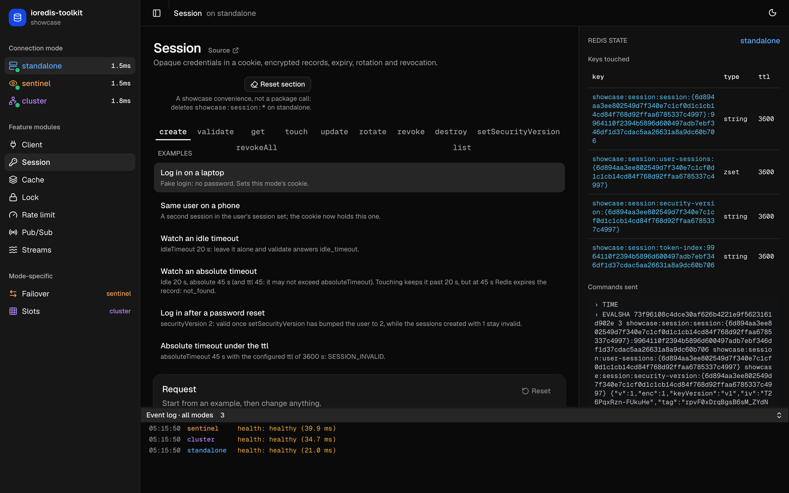

# ioredis-toolkit showcase

The official example and playground for [`ioredis-toolkit`](https://github.com/org-utils/ioredis-toolkit): every module, against standalone, sentinel and cluster at the same time.



**Prerequisites:** Node 24, pnpm via corepack (`corepack enable`), Docker.

## Quick start

```sh
git clone https://github.com/org-utils/redis-session-kit-example.git
cd redis-session-kit-example
pnpm install
pnpm dev
```

Then open http://localhost:3000. `pnpm dev` starts Redis in all three connection modes (with a RedisInsight each), generates a session encryption key on first run, and runs the backend and frontend.

## What you can try

Each section runs real package calls on the connection mode you pick in the sidebar, and links its backend code as **Source**.

| Section | What it shows | Source |
| --- | --- | --- |
| [Session](http://localhost:3000/?module=session) | Opaque credentials in a cookie, encrypted records, expiry, rotation and revocation | [`modules/session`](apps/backend/src/modules/session/) |
| [Client](http://localhost:3000/?module=client) | Config validation, namespaces, raw commands, health, shutdown | [`modules/client`](apps/backend/src/modules/client/) |
| [Cache](http://localhost:3000/?module=cache) | JSON values with TTL and conditional writes | [`modules/cache`](apps/backend/src/modules/cache/) |
| [Lock](http://localhost:3000/?module=lock) | Ownership-token leases | [`modules/lock`](apps/backend/src/modules/lock/) |
| [Rate limit](http://localhost:3000/?module=rate-limit) | Atomic fixed-window counters | [`modules/rate-limit`](apps/backend/src/modules/rate-limit/) |
| [Pub/Sub](http://localhost:3000/?module=pubsub) | JSON fan-out over a dedicated subscriber | [`modules/pubsub`](apps/backend/src/modules/pubsub/) |
| [Streams](http://localhost:3000/?module=streams) | Append, consumer groups, reads, acks | [`modules/streams`](apps/backend/src/modules/streams/) |
| [Failover](http://localhost:3000/?module=failover) (sentinel only) | A failover drill: move the master 6380 → 6381 while a workload runs, then check what survived | [`modules/failover`](apps/backend/src/modules/failover/) |
| [Slots](http://localhost:3000/?module=slots) (cluster only) | Key → hash slot → node, hash tags, cluster-aware fan-out | [`modules/slots`](apps/backend/src/modules/slots/) |

### Five-minute tour

1. [**Session**](http://localhost:3000/?module=session): on `create`, run **Log in on a laptop**. On `rotate`, run **Rotate after privilege change**, then **Replay the old token**: the consumed predecessor is refused with `SessionReplayError` (401), and its successor stays active.
2. [**Failover**](http://localhost:3000/?module=failover): pick **Graceful failover** and **Run drill**. Sentinel promotes the replica in about a second, and no call fails or reaches `onError`.
3. [**Slots**](http://localhost:3000/?module=slots): compare **Related keys, no hash tag**, which scatter across slots and nodes, with **Same keys with a hash tag**, which share one slot.
4. [**Rate limit**](http://localhost:3000/?module=rate-limit): on `burst`, run **Fill the window**: 15 consumes, 10 allowed and 5 denied with `retryAfterSeconds`.

## URLs and ports

| What | Where |
| --- | --- |
| App (Next.js) | http://localhost:3000 |
| Backend (Fastify) | http://localhost:4000, its API under `/api` (e.g. http://localhost:4000/api/status) |
| RedisInsight | standalone http://localhost:5542 · sentinel http://localhost:5541 · cluster http://localhost:5540 |
| Redis standalone | 6379 |
| Redis sentinel | master 6380 and replica 6381 (until a failover swaps them), sentinels 26379–26381 (`mymaster`) |
| Redis cluster | 7001–7003 |

## Scripts

Run from the repo root.

- `pnpm dev`: starts the infra, then the backend and frontend. Ctrl-C stops the apps and leaves Redis running.
- `pnpm dev:apps`: the backend and frontend only, against infra that is already up.
- `pnpm infra:up`, `pnpm infra:stop`, `pnpm infra:down`: start Redis and RedisInsight, stop them keeping the data, or remove them and wipe the data. Add `:<mode>` (`standalone`, `sentinel`, `cluster`) for one mode, e.g. `pnpm infra:down:cluster`.
- `pnpm redis:<mode>`: `redis-cli` inside that mode's stack, e.g. `pnpm redis:cluster GET showcase:cache:a`.
- `pnpm test`, `pnpm typecheck`: the backend tests (against the running infra) and the typecheck of every package.

To start over, `pnpm infra:down` wipes every mode; each section's **Reset section** button deletes just its own keys. [`infra/README.md`](infra/README.md) has the details.

## Configuration

Nothing to set: every default matches the infra ports. To change something, see [`apps/backend/.env.example`](apps/backend/.env.example) and [`apps/frontend/.env.example`](apps/frontend/.env.example). On first run, `pnpm dev` writes a random `SESSION_ENCRYPTION_KEY` into `apps/backend/.env`; keep that file, since replacing the key makes every stored session unreadable.

## How it's built

```
apps/backend/src/
  modules/<module>/     one Fastify plugin per section: the package calls (feature modules and mode-specific ones)
  app.ts                registers each feature module per mode at /api/<mode>/<module>, mode-specific ones on their mode
  redis/                the mode clients, health and status monitoring, the event log, the Redis trace
  http/                 errors, /api/status, the event stream
apps/frontend/
  components/showcase/  the shell and one component per section
  lib/showcase/         the examples, API calls and live status
packages/contracts/     Zod schemas shared by backend and frontend
infra/                  Docker Compose per mode, copied from the package, plus RedisInsight setup
scripts/                compose.mjs (runs docker compose per mode), ensure-env.mjs (the session key)
```

## Learn the package

- [README](https://github.com/org-utils/ioredis-toolkit#readme): the modules, configuration, connection modes and errors
- [`docs/`](https://github.com/org-utils/ioredis-toolkit/tree/main/docs): architecture, deployment, threat model, testing
- [`CONTEXT.md`](https://github.com/org-utils/ioredis-toolkit/blob/main/CONTEXT.md): the package's concepts and vocabulary

## Contributing

Start with [`AGENTS.md`](AGENTS.md) for how work is tracked and [`GLOSSARY.md`](GLOSSARY.md) for the showcase's vocabulary.

## License

MIT
